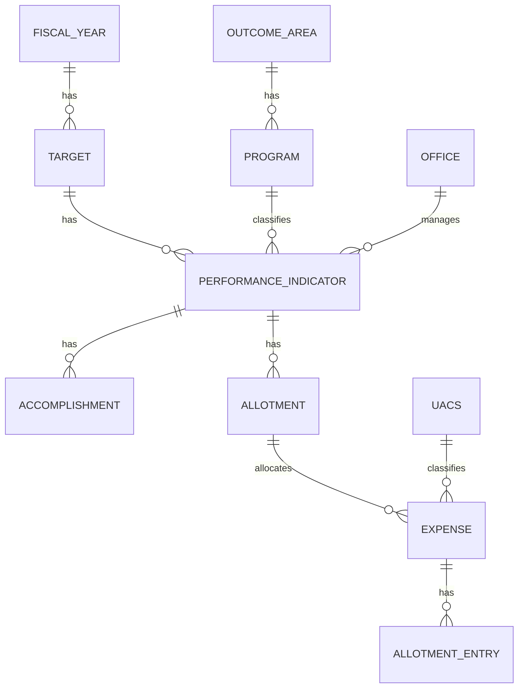
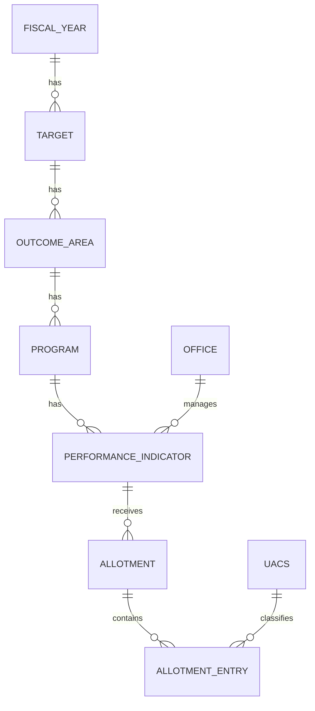

# TUGMA Project --- Development Memory, Progress, and Roadmap

**Project:** TUGMA --- Tracking Utilization and Goals through Monitoring
of Accomplishment\
**Application stack:** Laravel 13, Filament 5, Spatie Laravel
Permission\
**Last updated:** November 12, 2026\
**Purpose of this document:** A working project handover and continuity
reference for future development conversations.

------------------------------------------------------------------------

## Current checkpoint — November 12, 2026

This checkpoint supersedes conflicting statements in all older sections,
including the November 8 checkpoint, roadmap, and section 11. The older
material is retained as historical context, not a current specification.

### Data model and annual workflow

- Fiscal years have targets; each target has an OPB type (`current` or
  `continuing`) and performance indicators. Indicators belong to a target,
  program, and office; programs belong to an outcome area.
- Outcome areas and programs are shared classifications. They can be
  active or inactive, cannot be deleted through their policies, and a
  program cannot be moved to another outcome area. Historical displays
  still use the current shared names; no name snapshots are implemented.
- Targets also reference outcome areas and programs through the
  `outcome_area_target` and `program_target` pivot tables. The migration
  backfills distinct links from existing indicators. Saving an indicator
  attaches its target to its program and the program's outcome area.
  Classification selections can be edited on the target; selected
  programs must have selected outcome areas, and indicator-linked programs
  cannot be removed through that form.
- The target Duplicate action creates a new draft in the selected fiscal
  year and OPB type, reusing the source's attached classifications.
  It does **not** copy indicators, accomplishment periods or results,
  allotments, expenses, or financial entries. The operation is transactional;
  it requires target view/create and classification view permissions. A
  copied target can be duplicated again even without indicators.
- Targets group by fiscal year by default and can group/filter by OPB
  type. Indicators group by program or outcome area. Accomplishment status
  refers to the target's fiscal year, not an allotment year.

### Accomplishments and indicator summaries

- Accomplishments have a nullable `tag`: `met`, `unmet`, `cont`, `moved`,
  `na`, `exceeded`, or `deferred`. Tags remain on accomplishments, not
  indicators. Badge colors are success for met/exceeded, danger for unmet,
  warning for continuing/moved/deferred, and gray for N/A or other values.
- The accomplishment form separates target and accomplishment fields;
  `reason` is shown and required for a deferred tag. The table stacks
  quarter/semester and date/status, displays units, percentage suffixes,
  blank reasons as `-`, and supports authorized bulk deletion.
- The indicator Targets column displays actual versus target totals.
  Numeric units are summed; percentage units are averaged. Actuals below
  targets are danger, while equal or higher values are success; missing or
  nonnumeric values do not receive a comparison color. Individual actuals
  use the same threshold with icons.
- **Known schema gap:** application code and tests use a nullable string
  `accomplishments.target`, but the checked-in creation and subsequent
  migrations do not create that column. Fresh databases and tests therefore
  fail when writing it. Check the deployed database before adding a safe,
  data-preserving migration; do not assume the column is absent there.

### Dashboard and reports

- The App dashboard has fiscal year, OPB type, and office filters. The
  filter section spans the available width, with three columns on medium
  and wider screens and stacked fields on small screens. Inactive offices
  remain available. A blank filter means all values; the fiscal year
  defaults to the active or most recent year.
- Two tables show quarterly and cumulative quarterly OPB performance.
  A single grouped query counts accomplishment records by `target_quarter`,
  using the indicator's office and target's fiscal year and OPB type.
  Both tables display quarter, compliance, target count, met, exceeded,
  unmet, deferred, and N/A. `cont` is used in the formula but not shown
  separately; `moved` and untagged records count as targets but have no
  separate displayed accomplishment count. There is no cumulative-total
  target column.
- Quarterly compliance is `(met + exceeded) / (target - cont - deferred -
  na) * 100`; an empty or nonpositive denominator displays `—`. The
  cumulative table carries all counts forward and multiplies that formula
  by 0.25, 0.5, 0.75, and 1 for quarters 1–4, respectively, rounding to
  two decimal places. With all fiscal years selected, the query aggregates
  the same quarter across years before calculating cumulative values.
- Compliance badges use theme danger below 50%, warning from 50% to below
  85%, and success at 85% or more. Accomplishment headings and counts use
  Filament theme colors. Dashboard visibility requires the relevant fiscal
  year, target, and accomplishment view permissions.

### PHP 8.3 production preparation

- The intended production PHP version is 8.3.36. Composer now resolves
  against `config.platform.php = 8.3.36`; the locked Symfony dependencies
  were downgraded to compatible 7.4 versions, and Pest and its Laravel
  plugin were changed from 5.x to compatible 4.x versions. Laravel remains
  13 and Filament 5. Keep the platform setting and lock file consistent.
- On November 11, 2026, package discovery and Composer platform checks
  passed using the local PHP 8.3.36 binary, and focused target-classification
  tests passed (8 tests, 90 assertions). The default CLI reported PHP 8.4.27,
  separately from the site's PHP 8.3 runtime; verify both when deploying.
- The November 11 full run under PHP 8.3 reported 90 of 120 tests passing.
  Many errors involved the missing accomplishment target column; other
  failures included accomplishment behavior, admin navigation, the example
  response, and an outdated dashboard-heading expectation. Their exact
  causes were not all investigated, so do not assume all are pre-existing
  or dependency-related. The Composer security audit timed out and remains
  unverified.
- Deploy the committed lock file with `composer install --no-dev
  --optimize-autoloader`, then run `composer check-platform-reqs --no-dev`
  on the actual server. Confirm its PHP extensions, environment, database,
  migrations, and web/CLI runtimes before production. Run pending migrations
  deliberately; do not use `migrate:fresh` on data that must be retained.

### Key implementation references

- [Target resource](app/Filament/App/Resources/Targets/TargetResource.php),
  [duplication action](app/Actions/DuplicateTarget.php),
  [classification migration](database/migrations/2026_11_10_000001_create_target_classification_tables.php).
- [Accomplishment model](app/Models/Accomplishment.php),
  [accomplishment manager](app/Filament/App/Resources/PerformanceIndicators/RelationManagers/AccomplishmentsRelationManager.php),
  [indicator resource](app/Filament/App/Resources/PerformanceIndicators/PerformanceIndicatorResource.php).
- [Dashboard](app/Filament/App/Pages/Dashboard.php),
  [report service](app/Services/QuarterlyPerformanceReport.php),
  [report widget](app/Filament/App/Widgets/QuarterlyPerformance.php),
  [table view](resources/views/filament/app/widgets/quarterly-performance-table.blade.php).

------------------------------------------------------------------------

## Historical checkpoint — November 8, 2026

This checkpoint reflects the state recorded on November 8. Its duplication,
testing, and other details may be superseded by the current checkpoint.

### Current data structure



- A performance indicator belongs directly to a target, program, and
  office; its outcome area is derived through the program. Outcome areas
  and programs are reusable classifications, not children of a target.
- Outcome areas and programs have active/inactive status. Their deletion
  is denied by policy, and a program cannot be moved to another outcome
  area. Inactive classifications remain selectable and are labeled as
  inactive. Renaming a shared classification changes its display in
  historical records; snapshots or versioning are not implemented.
- Accomplishments belong to indicators. Their performance status uses
  the target's fiscal year rather than an allotment year.
- Expenses connect allotments to UACS classifications; allotment entries
  belong to expenses. Allotment totals are derived from expense amounts.

### Annual target workflow

- A target can be duplicated into a selected fiscal year and destination
  OPB type (`current` or `continuing`). The copy starts as a draft and
  its copied indicators start pending, retaining program and office.
- Copying planned accomplishment periods is optional. Actual values,
  accomplishment dates, descriptions, deferrals, reasons, remarks,
  allotments, expenses, and financial entries are not copied.
- Duplication runs in a database transaction and checks the relevant
  create and record-view permissions. No uniqueness rule for targets
  by fiscal year and OPB type has been added.

### Tables and permissions

- Targets are grouped by fiscal year by default; users can switch to
  OPB-type grouping and filter for Current or Continuing.
- Performance indicators are grouped by program by default, with the
  outcome area included in the group title; users can switch to grouping
  by outcome area. These are alternative groupings, not nested groups.
- The accomplishments table stacks quarter/semester and date/status,
  retains colored status badges, displays units and percentage suffixes,
  and shows `-` for a blank reason. Authorized users can bulk-delete
  accomplishments with individual record authorization.
- `RolePermissionSeeder` creates the accomplishment delete permission;
  it was run successfully during this session. Its role synchronization
  can reset permissions on predefined roles when rerun.

### Reset, validation, and follow-up

- The original create migrations were changed for the new structure;
  there is no data-preserving migration for the old target hierarchy.
  The user plans to delete existing data, but the schema reset was not
  performed by the assistant and its current status is unconfirmed.
  `php artisan migrate:fresh` drops **all** tables and data and should be
  run only when the user is ready. Seed roles/permissions afterward as
  needed; check the default database seeder before using `--seed`.
- Targeted relationship, duplication, grouping, authorization, and
  related regression tests passed during this work. The last full suite
  run reported three failures: two Admin navigation label expectations
  and the example home-page success expectation (actual redirect).
  The full suite was not rerun after the subsequent grouping changes.
- Confirm whether inactive classifications should be disallowed for new
  selections, whether historical names require snapshots, and whether
  duplicate destination targets should be restricted. These behaviors
  were not specified or implemented.

Key implementation files: [TargetResource](app/Filament/App/Resources/Targets/TargetResource.php),
[DuplicateTarget](app/Actions/DuplicateTarget.php),
[PerformanceIndicatorResource](app/Filament/App/Resources/PerformanceIndicators/PerformanceIndicatorResource.php),
and [AccomplishmentsRelationManager](app/Filament/App/Resources/PerformanceIndicators/RelationManagers/AccomplishmentsRelationManager.php).

------------------------------------------------------------------------

## 1. Project Overview

TUGMA is a web-based application for monitoring organizational targets,
performance indicators, allotments, and related
utilization/accomplishment information.

The project is a collaboration among:

-   **SRMU** --- performance management and physical accomplishment
    monitoring.
-   **Budget Unit (BUDGET)** --- allotment and financial utilization
    monitoring.
-   **RICTU** --- system administration, technical support, and
    application maintenance.

The application is being developed with:

-   Laravel 13
-   Filament 5
-   Spatie Laravel Permission
-   Shared Laravel `User` model and authentication database
-   Separate Filament Admin and App panels

### Current panel URLs

  Panel   Panel ID   URL path   Intended users
  ------- ---------- ---------- ---------------------
  Admin   `admin`    `/admin`   RICTU
  App     `app`      `/`        RICTU, SRMU, BUDGET

The panel ID is not the same as the URL path. Use `admin` and `app` in
authorization logic even though the App panel path is `/`.

------------------------------------------------------------------------

## 2. Roles and Access Requirements

### RICTU

-   System administrator.
-   Access to both Admin and App panels.
-   Manages users, roles, permissions, offices, fiscal years, settings,
    and system activity.
-   Has access to all application modules.

### SRMU

-   Access to the App panel only.
-   Manages targets, outcome areas, programs, performance indicators,
    and physical accomplishment functions.
-   Can view relevant financial/allotment reference information as
    authorized.

### BUDGET

-   Access to the App panel only.
-   Manages allotments, allotment entries, UACS reference data as
    authorized, and financial utilization functions.
-   Can view relevant performance/target reference information.

### Panel access logic

The intended `User::canAccessPanel(Panel $panel)` behavior is:

``` php
public function canAccessPanel(Panel $panel): bool
{
    return match ($panel->getId()) {
        'admin' => $this->hasRole('RICTU'),
        'app' => $this->hasAnyRole(['RICTU', 'SRMU', 'BUDGET']),
        default => false,
    };
}
```

The `User` model should implement `FilamentUser` and use Spatie's
`HasRoles` trait. Preserve existing model properties and methods when
integrating this code.

Assumption: roles use the `web` guard.

------------------------------------------------------------------------

## 3. Historical Database Architecture --- Superseded

The following original nine-model proposal is historical and does not
describe the current relationships. Use the November 8 checkpoint above.

The user revised the original model proposal. The current architecture
consists of these nine models:

1.  `FiscalYear`
2.  `Target`
3.  `OutcomeArea`
4.  `Program`
5.  `PerformanceIndicator`
6.  `Allotment`
7.  `AllotmentEntry`
8.  `Office`
9.  `Uacs`

### Current ERD



### Relationships

  --------------------------------------------------------------------------------------------------------------------------------------------------------------
  Parent model           Child model            Relationship on parent                   Relationship on child                      Foreign key
  ---------------------- ---------------------- ---------------------------------------- ------------------------------------------ ----------------------------
  FiscalYear             Target                 `hasMany(Target::class)`                 `belongsTo(FiscalYear::class)`             `fiscal_year_id`

  Target                 OutcomeArea            `hasMany(OutcomeArea::class)`            `belongsTo(Target::class)`                 `target_id`

  OutcomeArea            Program                `hasMany(Program::class)`                `belongsTo(OutcomeArea::class)`            `outcome_area_id`

  Program                PerformanceIndicator   `hasMany(PerformanceIndicator::class)`   `belongsTo(Program::class)`                `program_id`

  Office                 PerformanceIndicator   `hasMany(PerformanceIndicator::class)`   `belongsTo(Office::class)`                 `office_id`

  PerformanceIndicator   Allotment              `hasMany(Allotment::class)`              `belongsTo(PerformanceIndicator::class)`   `performance_indicator_id`

  Allotment              AllotmentEntry         `hasMany(AllotmentEntry::class)`         `belongsTo(Allotment::class)`              `allotment_id`

  Uacs                   AllotmentEntry         `hasMany(AllotmentEntry::class)`         `belongsTo(Uacs::class)`                   `uacs_id`
  --------------------------------------------------------------------------------------------------------------------------------------------------------------

### Important UACS correction

`Uacs` is a master/reference table. It is **not** a child collection of
`AllotmentEntry`.

-   Each `AllotmentEntry` selects one UACS classification through
    `uacs_id`.
-   One UACS code can be referenced by many allotment entries.
-   UACS identifies the type/nature of expense associated with a
    procurement activity.
-   `AllotmentEntry` therefore has `uacs()` as a `BelongsTo`
    relationship.
-   `Uacs` has `allotmentEntries()` as a `HasMany` relationship.

Example model methods:

``` php
// AllotmentEntry.php
public function uacs(): BelongsTo
{
    return $this->belongsTo(Uacs::class);
}

// Uacs.php
public function allotmentEntries(): HasMany
{
    return $this->hasMany(AllotmentEntry::class);
}
```

The `allotment_entries` table must contain `uacs_id`, and the `uacs`
table must be migrated before `allotment_entries`.

### Schema fields currently implemented

  -----------------------------------------------------------------------
  Table                               Main fields
  ----------------------------------- -----------------------------------
  `fiscal_years`                      `year`, `start_date`, `end_date`,
                                      `is_active`

  `targets`                           `fiscal_year_id`, `opb_type`
                                      (`current` or `continuing`),
                                      `status`

  `outcome_areas`                     `target_id`, `name`, `short_code`

  `programs`                          `outcome_area_id`, nullable
                                      `short_code`, `name`, nullable
                                      `description`

  `offices`                           `code`, `name`, `division`,
                                      `is_active`

  `performance_indicators`            `program_id`, `office_id`, `code`,
                                      `description`, `target_quarter`,
                                      nullable `responsible_person`,
                                      `date_accomplished`,
                                      `actual_accomplishment`, `remarks`,
                                      `status`

  `allotments`                        `performance_indicator_id`,
                                      `sub_allotment_number`, `year`,
                                      `authorization_type`, `amount`

  `allotment_entries`                 `allotment_id`, `uacs_id`,
                                      nullable `performance_indicator_code`,
                                      `entry_date`, `amount`

  `uacs`                              `code`, `description`
  -----------------------------------------------------------------------

Use `decimal(15,2)` for monetary amounts. The current database stores an
`amount` on both `Allotment` and `AllotmentEntry`. Confirm which value is
the source of truth for total allotment calculations before implementing
financial summaries; earlier requirements described the allotment total
as the sum of its entries.

### Migration deletion behavior

The current recommended default is `restrictOnDelete()` for all foreign
keys. TUGMA contains performance and financial history, so parent
deletion should not cascade-delete associated records.

Prefer deactivation, archival, cancellation, or reversal over hard
deletion of referenced operational/financial records.

------------------------------------------------------------------------

## 4. Historical Database Design Discussion --- Partly Superseded

The following reflects the earlier nine-model design. Accomplishment and
Expense models now exist; reassess any remaining reporting requirements
against the current implementation rather than this older proposal.

The nine-model foundation does not yet fully represent all previously
stated TUGMA business requirements.

The following requirements remain important:

-   SRMU updates physical accomplishments monthly.
-   BUDGET monitors obligations and disbursements.
-   Monthly financial amounts are incremental, not cumulative.
-   Updates should be reflected immediately; no approval workflow was
    requested.
-   Financial calculations include:
    -   Total allotment = sum of allotment entry amounts.
    -   Unobligated balance = allotment − obligations.
    -   Undisbursed obligations = obligations − disbursements.
    -   Utilization rates calculated against the appropriate
        allotment/obligation base.
-   Posted financial records should be protected from deletion; use
    reversals/cancellations and audit trails.
-   Activity logs should capture user, action, module, record, old/new
    values, and timestamp.

**Before finalizing the App Panel modules and dashboards, design how
monthly physical accomplishment, obligations, and disbursements will be
stored.** The current nine-model ERD does not yet include dedicated
models for these records. Do not silently assume that `AllotmentEntry`
alone covers those transaction requirements.

Potential additional models to assess (not yet approved): - Physical
accomplishment update / monthly accomplishment record. - Obligation
transaction or obligation entry. - Disbursement transaction or
disbursement entry. - Activity log / audit record, possibly using a
suitable package.

Determine whether obligation and disbursement data should be separate
transaction records, monthly summaries, or another structure before
writing migrations.

------------------------------------------------------------------------

## 5. Authorization Design

Spatie Laravel Permission is installed or has been used in the project.
The roles `RICTU`, `SRMU`, and `BUDGET` were previously created manually
after an earlier `RoleDoesNotExist` issue was resolved.

### Proposed permission naming convention

Use module-action permissions, for example:

``` text
targets.view
targets.create
targets.update
targets.delete

performance-indicators.view
performance-indicators.create
performance-indicators.update
performance-indicators.delete

allotments.view
allotments.create
allotments.update
```

Initial modules and permissions:

  Module                   Proposed permissions
  ------------------------ ------------------------------
  Fiscal Years             view, create, update, delete
  Targets                  view, create, update, delete
  Outcome Areas            view, create, update, delete
  Programs                 view, create, update, delete
  Offices                  view, create, update, delete
  Performance Indicators   view, create, update, delete
  Allotments               view, create, update
  Allotment Entries        view, create, update
  UACS                     view, create, update

Avoid routine deletion of financial records and UACS classifications
already in use.

### Initial permission matrix

  Module                   RICTU   SRMU   BUDGET
  ------------------------ ------- ------ --------
  Fiscal Years             Full    View, update   View
  Targets                  Full    Full   View
  Outcome Areas            Full    Full   View
  Programs                 Full    Full   View
  Offices                  Full    View   View
  Performance Indicators   Full    Full   View
  Allotments               Full    View   Full
  Allotment Entries        Full    View   Full
  UACS                     Full    View   View

"Full" means all defined actions for that module, except that financial
record deletion is intentionally excluded from the initial permission
set.

SRMU is explicitly allowed to update fiscal years. The existing
`FiscalYearPolicy` grants update access to RICTU and SRMU by role.

### Authorization implementation still to verify

-   Confirm Spatie package version and Laravel 13 compatibility.
-   Confirm Spatie migrations have run.
-   Confirm `User` model uses `HasRoles`.
-   Confirm `User` implements `FilamentUser`.
-   Confirm Admin and App panel IDs and paths.
-   Seed/synchronize roles and permissions.
-   Assign roles to test users.
-   Implement Laravel policies for all resources.
-   Restrict resource navigation and CRUD actions.
-   Verify direct URL access is blocked, not merely hidden from
    navigation.

A previous suggested seeder used `Role::firstOrCreate()`,
`Permission::firstOrCreate()`, and `syncPermissions()`. Review existing
roles and permissions before running it because `syncPermissions()`
replaces a role's current permission assignments.

------------------------------------------------------------------------

## 6. Development Progress

Progress below reflects what the user explicitly reported or what was
prepared in the conversation. Do not treat suggested code as implemented
unless the user confirms it.

  ---------------------------------------------------------------------------
  Workstream                  Status                  Notes
  --------------------------- ----------------------- -----------------------
  Laravel 13 project setup    Reported established    User is developing with
                                                      Laravel 13

  Filament 5 setup            Reported established    Multi-panel
                                                      architecture

  Admin panel route           Configured/planned      `/admin`

  App panel route             Configured/planned      `/`

  Shared User model           Existing                Shared authentication
                                                      across panels

  Spatie Permission           Installed/used          Version still needs
                                                      verification

  Roles                       Created previously      RICTU, SRMU, BUDGET

  Database migrations         User reports done       Nine-model foundation

  Eloquent models             User reports done       Nine models and
                                                      relationships

  UACS relationship           Clarified               AllotmentEntry
                                                      belongsTo Uacs

  Cascade delete policy       Recommended             `restrictOnDelete()`
                                                      for historical
                                                      integrity

  RBAC seeder                 Code proposed           Confirm whether
                                                      implemented and tested

  User panel access           Code proposed           Confirm whether
                                                      implemented and tested

  Fiscal Year Management      User reports done       Validation and related
                                                      to-do items completed;
                                                      implementation and tests
                                                      not independently verified

  Fiscal Year policy          Exists                  RICTU and SRMU can update;
                                                      tests not verified

  Office Management           Implemented             CRUD, validation, status,
                                                      policy, and deletion guard;
                                                      focused tests passed

  User Management             Implemented             RICTU-only CRUD, role
                                                      assignment, password rules,
                                                      and self-lockout safeguards;
                                                      focused tests passed

  Role and Permission         Implemented             RICTU-only role and
  Management                                          permission management;
                                                      focused tests passed

  App resources               Implemented              Target, Outcome Area,
                                                      Program, Performance
                                                      Indicator, Allotment,
                                                      Allotment Entry, UACS
                                                      resources available;
                                                      workflows/dashboard
                                                      still incomplete

  Physical accomplishment     Pending                 Needs schema decision
  data design                                         

  Obligations/disbursements   Pending                 Needs schema decision
  data design                                         

  Dashboards/reports          Pending                 Depends on finalized
                                                      transaction model

  Deployment and QA           Pending                 Later phase
  ---------------------------------------------------------------------------

------------------------------------------------------------------------

## 7. Current Development Roadmap / To-Do List

### Phase 1 --- Project Setup

-   [x] Laravel 13 project established.
-   [x] Filament 5 selected.
-   [x] Database configured (confirm current environment).
-   [ ] Confirm environment configuration and Git repository practices.
-   [ ] Confirm backups and safe migration workflow.

### Phase 2 --- Multi-Panel Architecture

-   [x] Admin panel concept established.
-   [x] App panel concept established.
-   [x] Admin panel path `/admin`.
-   [x] App panel path `/`.
-   [ ] Verify panel IDs are exactly `admin` and `app`.
-   [ ] Verify shared authentication works in both panels.
-   [ ] Verify RICTU can access both panels.
-   [ ] Verify SRMU and BUDGET cannot access Admin.

### Phase 3 --- Database Architecture

-   [x] Nine models identified.
-   [x] Migrations and models reported complete by user.
-   [x] Core Eloquent relationships defined.
-   [x] UACS reference relationship corrected.
-   [ ] Run/confirm migration status in the active environment.
-   [ ] Test all relationships with Tinker.
-   [ ] Review indexes, unique constraints, nullable fields, and delete
    restrictions.
-   [ ] Design monthly physical accomplishment records.
-   [ ] Design obligation and disbursement transaction records.
-   [ ] Confirm audit/history requirements.

### Phase 4 --- Authentication and RBAC (user confirmed complete)

-   [x] Verify installed Spatie package version and guard configuration.
-   [x] Configure `User` model (`FilamentUser`, `HasRoles`) and
    `canAccessPanel()`.
-   [x] Verify panel IDs, routes, role assignments, and access for the
    three core roles.
-   [x] Establish role-permission seeding and direct URL/action checks.
-   [x] Add policies alongside Admin resources; add module policies as
    App resources are implemented.

### Phase 5 --- Admin Panel Development

Admin modules:

1.  Dashboard
2.  User Management
3.  Role Management
4.  Permission Management
5.  Office Management
6.  Fiscal Year Management
7.  Activity Logs
8.  System Settings

Recommended implementation sequence:

-   [ ] Verify `AdminPanelProvider.php`.
-   [x] Generate `OfficeResource` for the admin panel.
-   [x] Configure `OfficePolicy` and prevent deletion of offices with
    performance indicators, including in bulk actions.
-   [x] Fiscal Year policy exists; RICTU and SRMU can update.
-   [x] Configure Office form, table, and active/inactive status filter.
-   [x] Fiscal Year validation and related to-do items completed, as
    reported by the user; implementation has not been independently
    verified.
-   [x] Validate required Office fields, field lengths, and unique codes.
-   [x] Build User Management with RICTU-only authorization, validated
    role assignment, password handling, and self-lockout safeguards.
-   [x] Build Role Management with protected core roles, permission
    assignment, and safeguards for roles assigned to users.
-   [x] Build Permission Management with protected existing names and
    automatic RICTU assignment for new permissions.
-   [x] Build the Admin UACS resource with validated code and description,
    permission-based access, and no deletion actions.
-   [x] Build Activity Logs with a read-only, RICTU-only admin view.
-   [x] Build System Settings for the display name and support email.
-   [ ] Build Admin Dashboard.
-   [ ] Test all admin actions and authorization.

**Current checkpoint:** The user reports that Fiscal Year validation
and related to-do items are complete. Office Management CRUD, validation,
status, and policy are implemented. The targeted delete-permission seeder
was applied to grant RICTU `offices.delete` without replacing existing
permissions. User Management is implemented for RICTU, with role
assignment and protection against removing one's own roles or deleting
one's own account. The users table has no active-status column. On
November 3, 2026, Activity Logs and System Settings were implemented and
their additive migration applied. Admin UACS management now supports
searching, creating, and updating classifications. The existing example
test still fails because `/` redirects to login instead of returning
HTTP 200.

Relevant commands previously proposed:

``` bash
php artisan make:filament-resource Office --panel=admin

php artisan make:policy OfficePolicy --model=Office

php artisan optimize:clear
php artisan route:list --path=admin
```

Admin panel provider should retain existing middleware, plugins,
discovery settings, and widgets. Relevant configuration:

``` php
return $panel
    ->id('admin')
    ->path('admin')
    ->login()
    ->brandName('TUGMA Administration')
    ->strictAuthorization();
```

Use `strictAuthorization()` only after policies for the resources are in
place, because missing policy methods may cause authorization failures.

### Phase 6 --- App Panel Development (current phase)

Planned App modules:

-   Targets
-   Outcome Areas
-   Programs
-   Performance Indicators
-   Allotments
-   Allotment Entries
-   UACS
-   Monthly Physical Accomplishments (after schema design)
-   Obligations and Disbursements (after schema design)

Tasks:

-   [ ] Complete App Panel navigation and a TUGMA-specific dashboard.
-   [x] Generate initial Target, Outcome Area, and Program resources.
-   [x] Configure their forms, tables, and parent relationships.
-   [x] Implement role permissions and prevent deleting parent records
    with children.
-   [x] Build Performance Indicator management for program, office,
    code, description, target quarter, responsible person, status, and
    remarks.
-   [x] Build Allotment, Allotment Entry, and App Panel UACS resources
    with BUDGET/SRMU permissions and no delete actions.
-   [ ] Implement monthly physical accomplishment workflow.
-   [ ] Implement financial transaction workflows.
-   [ ] Validate computations and transaction integrity.

### Phase 7 --- Dashboards and Reporting

-   [ ] Overall TUGMA dashboard.
-   [ ] Fiscal year filtering.
-   [ ] Target and performance indicator summaries.
-   [ ] Physical accomplishment versus target.
-   [ ] Allotment and financial utilization summaries.
-   [ ] Obligations and disbursements.
-   [ ] Office-level reports.
-   [ ] Export/print reports as needed.
-   [ ] Verify calculations against sample records.

### Phase 8 --- Security, Quality Assurance, and UAT

-   [ ] Test authentication and panel access.
-   [ ] Test policy authorization and direct URL restrictions.
-   [ ] Validate input and financial rules.
-   [ ] Protect posted transactions from destructive edits/deletions.
-   [ ] Add audit logging.
-   [ ] Test backups and restoration.
-   [ ] Conduct SRMU, BUDGET, and RICTU user acceptance testing.
-   [ ] Fix usability and performance issues.

### Phase 9 --- Deployment and Operations

-   [ ] Prepare production environment.
-   [ ] Configure HTTPS and secure environment variables.
-   [ ] Configure database backup schedule.
-   [ ] Configure queue/cache/session services as needed.
-   [ ] Configure logs and monitoring.
-   [ ] Deploy migrations and seed required reference data.
-   [ ] Create initial RICTU administrator account securely.
-   [ ] Prepare user guide and administrator documentation.
-   [ ] Conduct rollout and capability-building.

------------------------------------------------------------------------

## 8. Admin Panel Design Details

### Office Management

Implemented in the Admin panel. The current schema uses `division` rather
than a description field. Office deletion requires `offices.delete` and
is blocked when performance indicators reference the office. Bulk
deletion checks the policy for each selected office. Database foreign-key
restrictions also protect referenced offices.

The Office table includes an inline active/inactive toggle. Changing it
requires the Office policy's update permission.

Suggested form fields:

-   Office Code --- required, unique.
-   Office Name --- required.
-   Division --- required.
-   Active Status --- boolean.

Suggested table columns:

-   Code
-   Name
-   Active status
-   Date created

Business rule: prevent deletion of an office referenced by performance
indicators. Deactivate it instead.

### Fiscal Year Management

The user reports that validation and related to-do items are complete.
The details below describe the intended design, not an independent
verification of the implementation.

Suggested form fields:

-   Year --- required, unique.
-   Start Date --- required.
-   End Date --- required and after start date.
-   Active Status --- boolean.

Suggested table columns:

-   Year
-   Start Date
-   End Date
-   Active status

Business rule: only one fiscal year should be active at a time.
Implement the rule server-side, preferably within a database
transaction. Do not rely only on a UI toggle.

### User Management

Implemented for RICTU in the Admin panel:

-   Name and unique email are required.
-   One or more existing `web` guard roles are required.
-   Password and confirmation are required on creation and optional on
    edit; passwords require at least 12 characters and at most 72 bytes.
-   Administrators cannot change their own roles or delete themselves,
    including through bulk deletion.
-   The users table does not have an `is_active` field; account
    activation/deactivation has not been implemented.

### Role and Permission Management

-   RICTU can create and edit `web` guard roles and assign existing
    permissions. Spatie's permission cache is refreshed when assignments
    change.
-   The three core roles (RICTU, SRMU, BUDGET) cannot be renamed or
    deleted. RICTU's permission assignments cannot be edited in the UI.
-   Custom roles can be deleted only when not assigned to a model;
    bulk deletion applies the same per-role check. A custom role alone
    does not grant panel access: a core role is also needed.
-   Permissions use `module.action` names. RICTU can create permissions,
    which are automatically granted to RICTU. Existing permissions
    cannot be renamed or deleted through the UI. New permissions also
    require application authorization checks before they have an effect.
-   `FiscalYearPolicy::update` checks RICTU/SRMU roles directly, so
    changing `fiscal-years.update` assignments does not alter that
    particular policy's behavior.
-   Running `RolePermissionSeeder` synchronizes and replaces the SRMU
    and BUDGET permission assignments. Do not rerun it without reviewing
    changes made through Role Management.

------------------------------------------------------------------------

## 9. Technical and Development Conventions

-   Use Laravel 13 and Filament 5-compatible APIs.
-   Do not copy code written for older Filament major versions without
    checking compatibility.
-   Preserve existing files and configuration; provide targeted edits
    rather than replacing entire providers unnecessarily.
-   Use exact file paths and commands.
-   Explain whether code is a complete file or an excerpt.
-   Do not run `php artisan migrate:fresh` because it drops existing
    data, including users and role assignments.
-   Use `php artisan optimize:clear` after relevant configuration
    changes.
-   Use `php artisan migrate` for new migrations after reviewing them.
-   Use `restrictOnDelete()` for historical/financial foreign keys
    unless a deliberate, documented exception is approved.
-   Use decimal types for monetary values.
-   Prefer deactivation, archival, cancellation, and reversal over
    deleting records with operational history.
-   Test relationships and authorization with Tinker and actual test
    accounts.
-   Hiding a Filament navigation item is not a substitute for
    server-side authorization through policies.

------------------------------------------------------------------------

## 10. Immediate Next Actions

The following notes are historical checkpoints, not the current task
list. See the November 8 checkpoint for the latest status and follow-up.

The current active phase is **Phase 6 --- App Panel Development**.

The next practical actions are:

1.  Use the sum of Expense amounts as the total for each Allotment;
    the Expense restructuring checklist records the implementation status.
2.  Design monthly physical accomplishment, obligation, and
    disbursement records before implementing those workflows or related
    dashboards.
3.  Define and validate the fund utilization calculations after the
    transaction model is settled.
4.  Build App reporting and dashboard features after those data decisions;
    keep the Admin Dashboard deferred as requested.

### Expense restructuring TODO

-   [x] Confirm existing allotments and entries were deleted; no
    allocation backfill is required. The migration guards against
    running while either legacy table contains rows.
-   [x] Add the Expense model and migration with allotment_id, uacs_id,
    and decimal amount; add the requested relationships.
-   [x] Replace the entry's direct allotment/UACS references with
    expense_id and remove allotments.amount. The migration was applied.
-   [x] Derive Allotment totals from Expense amounts and calculate
    utilized and remaining amounts at Expense and Allotment levels.
-   [x] Enforce that entries cannot exceed their Expense allocation and
    Expense amounts cannot be reduced below utilized amounts.
-   [x] Add an Expense relation manager under Allotments and an
    Allotment Entry relation manager under Expense.
-   [x] Make the entry form's Allotment selection filter Expenses by
    that Allotment; display the Expense's UACS code and description and
    save the selected expense_id.
-   [x] Update utilization tables, Performance Indicator summaries,
    activity observation, and Expense policy authorization.
-   [ ] Update existing tests for the new Expense relationships and
    financial validation; tests have not been run.

### Follow-up App work

-   [ ] Design monthly physical accomplishment, obligation, and
    disbursement records before implementing those workflows.
-   [ ] Build App reporting and dashboards after transaction rules are
    settled; keep the Admin Dashboard deferred as requested.

### App Panel checkpoint (November 3, 2026)

-   The App panel uses the `app` ID and root path and now groups modules
    under Performance Management and Financial Management.
-   Target, Outcome Area, and Program resources are available in the App
    panel. Their policies use the existing module permissions; SRMU can
    manage these modules and BUDGET can view them according to the
    current role-permission seeder.
-   Deletion is blocked for targets with outcome areas, outcome areas
    with programs, and programs with performance indicators. Bulk delete
    actions authorize each record individually.
-   These resources follow the implemented columns: targets use fiscal
    year, OPB type, and status; outcome areas use name and short code;
    programs use optional short code, name, and description.
-   Performance Indicator management uses its program and office
    relationships and quarterly planning fields. Its policy follows
    `performance-indicators.*` permissions and blocks deletion when
    allotments exist. The legacy single `date_accomplished` and
    `actual_accomplishment` columns are not exposed as a monthly-entry
    workflow; monthly accomplishment design remains open.
-   The App Panel includes Allotment and Allotment Entry management for
    the current schema, plus UACS reference management. Financial record
    deletes are not exposed. The unique sub-allotment number is validated
    within its performance indicator; an entry date is validated unique
    within its allotment and UACS code.
-   Performance Indicator and Allotment resources use record pages with
    relation managers for their respective has-many relationships.
    Allotments can be created/edited from a Performance Indicator;
    entries can be created/edited from an Allotment. Related financial
    records cannot be deleted or reparented from these managers.
-   The November 4 Expense restructuring checkpoint supersedes the
    earlier amount note: Allotments no longer store amount directly;
    totals are derived from their Expense amounts.
-   Expense allocations and Allotment Entry workflows are implemented
    under the Expense schema described in the November 4 checkpoint.
    Monthly accomplishments, obligations, disbursements, and dashboards
    remain open.

### Activity Logs and System Settings checkpoint (November 3, 2026)

-   The additive migration for activity logs and system settings was
    applied without resetting existing data.
-   RICTU can inspect activity logs, filter by module or action, and view
    previous and new values. The admin interface does not allow logs to
    be created, edited, or deleted. Actor names remain available when a
    user is deleted; passwords, tokens, and secrets are excluded or
    redacted.
-   Eloquent create, update, and delete events on the existing business
    models, users, roles, permissions, and settings are logged. Role and
    permission assignments made through the existing management forms
    are also logged. Bulk SQL changes, assignments made outside those
    forms, sign-ins, and changes before installation are not captured.
    Audit records are not a tamper-proof external audit trail.
-   RICTU can configure the application display name, used by both
    panels, and a stored support email. The support email does not
    configure outgoing mail. No maintenance-mode setting was added.
-   Focused tests cover changes, redaction, transactional rollback,
    assignment changes, settings, and access restrictions.

### Admin UACS checkpoint (November 3, 2026)

-   The admin UACS resource uses the existing `uacs` table and the
    `uacs.view`, `uacs.create`, and `uacs.update` permissions; no schema
    migration or permission reseeding was required.
-   The existing BUDGET role has create and update permissions, despite
    the earlier proposed matrix listing view only. Its users cannot
    access the RICTU-only Admin panel. The policy respects existing
    permissions for use by future authorized application features.
-   Codes and descriptions are required, codes are unique, and both
    fields are limited to 255 characters. UACS classifications cannot
    be deleted through the resource or policy; the database also restricts
    deletion of classifications referenced by allotment entries. Create
    and update operations use the existing activity log.

### Admin navigation checkpoint (November 3, 2026)

-   Dashboard remains ungrouped. System Management contains System
    Management (the existing System Settings page), Fiscal Years, UACS,
    and Offices, in that order.
-   User Management contains Users, Roles, Permission, and Activity Logs,
    in that order. Existing resource permissions and panel access checks
    continue to determine which navigation items are visible.

### App financial and indicator checkpoint (November 4, 2026)

-   The Allotment Entry form's allotment selector searches both the
    sub-allotment number and the related Performance Indicator code.
    Option labels include the sub-allotment number, indicator code, and
    allotment year. The entry's performance_indicator_code field is
    labeled "Reference (PR/PO No.)"; it remains distinct from the
    indicator code associated with the allotment.
-   Allotment Entry table columns include sub-allotment (with its
    associated Performance Indicator code), UACS code, reference, entry
    date, and amount.
-   The Allotment table shows utilized amount as the sum of that
    allotment's entry amounts. Its utilization percentage uses the
    allotment's own amount as the denominator; the percentage badge is
    gray at zero, red for 1–49%, yellow for 50–84%, and green for 85% or
    higher (capped at 100%).
-   Performance Indicator status is derived from target quarter and
    accomplishment date: Pending (gray), Ahead (green), On Time (blue),
    or Late (red). Since Performance Indicators do not have a target-year
    field, the current helper uses the earliest related allotment year
    for the target year. Revisit this if indicators may have allotments
    across multiple years or need an explicit target year.
-   These table and form changes have PHP diagnostics reporting no
    errors; no test run was reported for these latest changes.

### Expense restructuring checkpoint (November 4, 2026)

-   The user confirmed that all existing Allotments and Allotment Entries
    had been deleted before the schema restructure. The migration also
    checks both tables and aborts if legacy rows remain.
-   Expense has allotment_id, uacs_id, and amount. Each Allotment allows
    one Expense per UACS. Allotment Entry now belongs only to Expense;
    Allotment total allocation is derived from the sum of Expense
    amounts.
-   The migration was applied. Allotment no longer stores amount, and
    Allotment Entry now stores expense_id instead of allotment_id and
    uacs_id.
-   Allotment pages manage Expenses through a relation manager. A hidden
    Expense view page provides its Allotment Entry relation manager.
    Standalone entry creation first selects an Allotment, then offers
    only Expenses/UACS classifications recorded under that Allotment.
-   Entry writes lock their Expense and cannot exceed its remaining
    allocation. Expense allocations cannot be reduced below their
    utilized amount.
-   Utilization displays and Performance Indicator aggregate queries
    now follow the Expense relationship. PHP diagnostics found no errors;
    Artisan migration, schema inspection, model inspection, and route
    discovery succeeded. Tests were not run; existing tests still need
    review for the updated relationships.

**Do not assume that a task is completed merely because code was
suggested.** Update this document's progress table when the user
confirms implementation or provides evidence such as command output,
code, or successful tests.

------------------------------------------------------------------------

## 11. Key Project Decisions to Preserve

-   Project name: TUGMA --- Tracking Utilization and Goals through
    Monitoring of Accomplishment.
-   Stack: Laravel 13 + Filament 5.
-   Admin panel path: `/admin`.
-   App panel path: `/`.
-   Shared User model/authentication.
-   Roles: RICTU, SRMU, BUDGET.
-   RICTU accesses both panels; SRMU and BUDGET access App only.
-   `PerformanceIndicator` belongs to `Target`, `Program`, and `Office`;
    outcome area is derived through its program.
-   Outcome areas and programs are reusable classifications with active
    status; policy disallows deletion and programs cannot be reparented.
-   `AllotmentEntry` belongs to `Expense`; an expense belongs to an
    `Allotment` and a reusable `Uacs` classification.
-   Foreign keys should generally restrict deletion to preserve
    historical data.
-   Accomplishments exist as indicator records. Further monthly reporting,
    obligation, and disbursement requirements need separate assessment.
-   SRMU is allowed to update fiscal years.
-   Current development focus: App Panel performance management and
    yearly target workflows, followed by outstanding reporting and QA.
